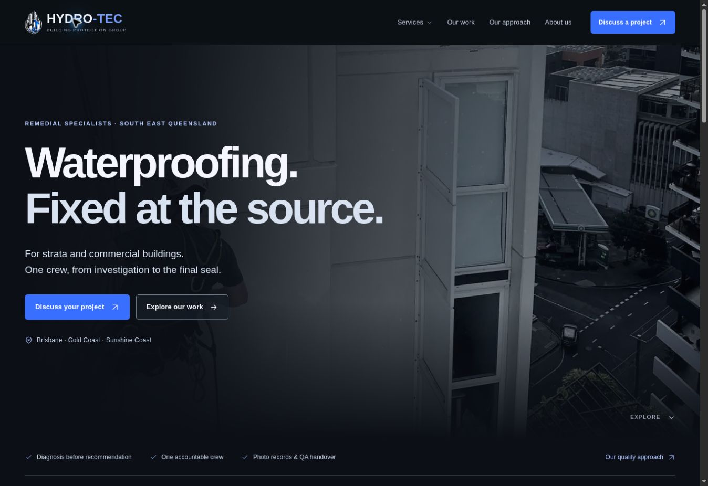

# Hydro-Tec website rebuild

A connected, cinematic website for Hydro-Tec Building Protection Group. The build produces **23 complete HTML documents**: 22 content pages and a 404 page. Navigation uses ordinary document URLs, not a single-page mockup or hash router.

GitHub development repository: [edafeo1/noxy](https://github.com/edafeo1/noxy). See [the GitHub workflow guide](docs/github-setup.md) for automatic build checks and the separately configured AWS staging deployment.

AWS staging is deployed at **[d3s90nqnvv0rq0.cloudfront.net](https://d3s90nqnvv0rq0.cloudfront.net)** using private S3 storage and CloudFront. See [the deployment record](docs/aws-staging-status.md) for the account, cost choices, checks and remaining integrations. The connected account remains on its existing AWS Free account plan. GitHub-to-AWS deployment is still disabled pending an organisation IAM permission issue.

## Develop

Requirements: Node.js 22 or newer. The static build has no third-party package dependencies.

```bash
npm run build
npm run check
```

In the managed workspace:

```bash
sites-preview start /workspace/sites/hydrotec-cinema
```

Outside this workspace, serve `dist/` with a static file server that resolves directory `index.html` files. For example, Python’s standard server:

```bash
python3 -m http.server 8080 --directory dist
```

## Source layout

| Path | Purpose |
|---|---|
| `src/content.mjs` | Company details, six services, gallery metadata, FAQs and process copy |
| `src/site.css` | Shared visual system, responsive layouts, keyboard focus and reduced motion |
| `src/app.js` | Mobile navigation, card rows, gallery filters and viewer, enquiry submission |
| `scripts/build.mjs` | Shared layouts, individual pages, metadata, sitemap and static build |
| `scripts/check.mjs` | Internal links, asset references, anchors, titles, IDs and syntax checks |
| `dist/` | Portable, deployable website |
| `infrastructure/aws-static-site.yml` | AWS hosting template and optional scoped GitHub staging role |
| `backend/enquiry.py` | Validate, save and queue enquiry references with abuse limits |
| `backend/delivery.py` | Fixed-recipient SES delivery, retries and duplicate checks |
| `public/assets/` | Original project photos and committed responsive WebP variants |
| `infrastructure/aws-enquiries.json` | Generated API, queue, worker, private backups and alert infrastructure |
| `docs/enquiries.md` | Enquiry verification, operation, domain and advertising setup |
| `docs/aws-setup.md` | First-time AWS account and GitHub staging setup |
| `docs/aws-deployment.md` | AWS setup, deployment and production handover |
| `docs/launch-readiness.md` | Remaining owner inputs and launch decisions |

## Routes

- `/`
- `/services/` and six individual service pages
- `/projects/`, `/projects/broadway-on-ann/`, `/projects/gallery/`
- `/approach/`, `/who-we-help/`, `/about/`
- `/faqs/`, `/quality-and-warranty/`
- `/contact/`, `/privacy/`
- `/service-areas/`, plus Brisbane, Gold Coast and Sunshine Coast pages
- `/404.html`

Every service links to related services, project information and a contextual enquiry. Every document shares the navigation and footer. The gallery supports category URLs, accessible filter buttons, keyboard navigation and a native dialog photo viewer.

## Enquiries

The form validates and saves enquiries in Sydney, then queues a reference for delivery by a separate SES worker. Fixed sender and recipient parameters, duplicate checks, bounded retries and operator alerts protect the flow. The preview currently uses a verified test route; the business domain and business inbox must be authenticated before production launch. See [enquiry operations](docs/enquiries.md) and [the current release status](docs/operations.md).

Set `ENQUIRY_ENDPOINT` when building for AWS. Builds without that setting retain the email-app fallback and its matching disclosure. The live browser test and operator-alert email were verified in the test inbox. Repeat end-to-end verification after any production sender or domain change.

## Production build

The preview is excluded from search indexing. Before the final domain deployment:

```bash
SITE_ORIGIN=https://hydrotecbuildingprotectiongroup.com.au SITE_INDEXABLE=1 npm run build
npm run check
```

Only enable indexing once the domain, business content and production enquiry handling are ready. `SITE_ORIGIN` controls canonical URLs, social metadata, structured data and sitemap entries. Site registration metadata belongs in `.openai/hosting.json`; never copy a different project identity into an existing checkout.

## Content grounding

Copy and photographs were adapted from the existing Hydro-Tec website and its two-page capability statement. The statement confirms Noxy Adams as the contact and the four-part scope of two Broadway on Ann balcony restorations. No project duration, warranty period, licence number, named insurer, testimonial or measured long-term outcome has been invented. General gallery images are not presented as additional named case studies.

The original capability statement is included at `/assets/hydro-tec-capability-statement.pdf`. See the launch-readiness document for the business details still needed.

## Current improvements and Google launch

The AWS preview includes responsive WebP photos, intrinsic image dimensions, versioned application assets, CSP and anti-framing headers, service/breadcrumb structured data, distinct regional copy and staging noindex protection. Both build modes, link/security checks, infrastructure schemas and 18 delivery tests run in CI.

See [operations](docs/operations.md) for current verification and limits, [Google setup](docs/google-launch-plan.md) for account ownership and verification, and [the paused advertising brief](marketing/google-search-draft.json) for keyword and ad-copy drafts. No Google Ads budget, campaign activation or tracking tag is configured.


